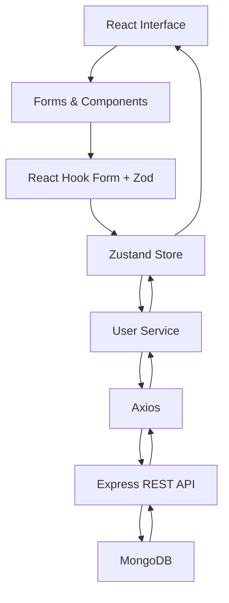

<div align="center">

# USERSCRUD

### Frontend Application

A React-based user management interface connecting
validated forms, client-side state, and REST API operations.

**React · TypeScript · Vite · Zustand · Axios · Tailwind CSS**

[**Backend Repository**](https://github.com/0sayo0/usercrud-backend) ·
[**Developer Portfolio**](https://jonathanmoralesdev.com)

</div>

---

## Overview

**UsersCRUD Frontend** is the client-side application of
a full-stack user management project.

It provides an interface for creating, viewing,
updating, searching, and deleting user records
stored in a MongoDB database through a separate
Express REST API.

The project explores how a React application can
coordinate multiple responsibilities:

- Form handling and validation.
- Client-side state management.
- Asynchronous HTTP communication.
- User interface interactions.
- Data presentation.
- Reusable components.

The frontend and backend are maintained in
separate repositories, establishing an explicit
boundary between presentation and data persistence.

---

## Features

### User Management

The application provides interfaces for:

- **Create:** Register users through a validated form.
- **Read:** Retrieve and display existing users.
- **Update:** Modify user information through an edit dialog.
- **Delete:** Remove individual user records.
- **Details:** Inspect information associated with a user.

### User Search

A search field filters the loaded user records
by the beginning of their names.

Matching records are displayed in a dropdown
containing names and email addresses.

### Form Validation

React Hook Form and Zod validate user information
before it is submitted to the API.

Validation includes:

- Required name and minimum length.
- Positive age.
- Valid email format.
- Required role and minimum length.

### State Management

Zustand centralizes the user collection and
asynchronous CRUD actions.

The store coordinates data retrieval, creation,
updates, and deletion.

### Interactive Interface

The application includes:

- Responsive user cards.
- Create and edit dialogs.
- User detail dialogs.
- Animated transitions.
- Loading indicators.
- Icon-based actions.

---

## Technology Stack

| Category         | Technologies        |
| ---------------- | ------------------- |
| UI Library       | React 19            |
| Language         | TypeScript          |
| Build Tool       | Vite 8              |
| Styling          | Tailwind CSS v4     |
| State Management | Zustand 5           |
| HTTP Client      | Axios               |
| Forms            | React Hook Form     |
| Validation       | Zod                 |
| Form Integration | @hookform/resolvers |
| UI Components    | Headless UI         |
| Animations       | Motion              |
| Icons            | Lucide React        |
| Code Quality     | ESLint              |

---

## Application Architecture

The frontend uses a modular organization that
separates API configuration, shared components,
and user-related functionality.

```text
usercrud-frontend/
│
├── src/
│   ├── api/
│   │   └── axiosInstance.ts
│   │
│   ├── components/
│   │   ├── CreateDialog.tsx
│   │   ├── CreateForm.tsx
│   │   ├── DetailsDialog.tsx
│   │   ├── EditDialogForm.tsx
│   │   ├── Navbar.tsx
│   │   └── TopBtns.tsx
│   │
│   ├── features/
│   │   └── users/
│   │       ├── components/
│   │       │   ├── UserCard.tsx
│   │       │   ├── UserCardBtns.tsx
│   │       │   ├── UserList.tsx
│   │       │   └── UserSearchMenu.tsx
│   │       │
│   │       ├── schemas/
│   │       │   └── userSchema.ts
│   │       │
│   │       ├── services/
│   │       │   └── userService.ts
│   │       │
│   │       ├── store/
│   │       │   └── useUserStore.ts
│   │       │
│   │       └── types/
│   │           └── user.types.ts
│   │
│   ├── App.tsx
│   ├── index.css
│   └── main.tsx
│
├── package.json
├── tsconfig.json
└── vite.config.ts
```

### Architectural Responsibilities

**`src/api/`**

Contains the shared Axios instance, including
the API base URL, request timeout, and default headers.

**`src/components/`**

Contains interface components used to compose
the application's principal interactions.

These include dialogs, forms, navigation,
and top-level action buttons.

**`src/features/users/components/`**

Contains user-specific presentation components,
including cards, lists, action buttons, and search results.

**`src/features/users/schemas/`**

Defines Zod schemas for creating and updating users.

**`src/features/users/services/`**

Encapsulates HTTP requests to the backend API.

**`src/features/users/store/`**

Centralizes user data and asynchronous operations
using Zustand.

**`src/features/users/types/`**

Defines TypeScript types for user records
and request payloads.

---

## Data Flow

The application coordinates user interactions
through a predictable sequence of responsibilities.



### Example: Creating a User

1. The user opens the creation dialog.
2. React Hook Form manages the form values.
3. Zod validates the submitted information.
4. The validated data is passed to a Zustand action.
5. The store delegates the request to `userService`.
6. Axios sends a POST request to the backend.
7. The backend processes and persists the user.
8. The API returns the created record.
9. Zustand updates the local user collection.
10. React renders the updated information.

---

## State Management

Zustand manages the application's shared user state.

The store defines:

| State / Action | Responsibility                    |
| -------------- | --------------------------------- |
| `users`        | Collection of loaded user records |
| `isLoading`    | User-list loading state           |
| `isSubmitting` | Create/update submission state    |
| `toFetchUsers` | Retrieve existing users           |
| `toCreateUser` | Create a user                     |
| `toUpdateUser` | Update an existing user           |
| `toDeleteUser` | Delete an existing user           |

This separates shared user data and CRUD operations
from individual presentation components.

---

## Engineering Decisions

### React + TypeScript

React provides the component model and interactive
rendering layer.

TypeScript defines contracts for user records,
request payloads, and component properties.

### Zustand for Client State

Zustand manages shared user information and
coordinates CRUD operations.

The store updates the local collection after
successful create, update, and delete responses.

### Axios for HTTP Communication

A shared Axios instance provides a consistent
configuration for requests to the backend.

The service layer keeps HTTP communication
separate from presentation components.

### React Hook Form + Zod

React Hook Form manages form values and submissions,
while Zod defines validation rules.

The resolver connects both libraries so
form validation follows a centralized schema.

### Tailwind CSS

Tailwind CSS provides utility-based styling
for the responsive interface.

### Headless UI

Headless UI provides components used to build
dialogs, forms, and interactive controls.

### Motion

Motion-based animations add visual feedback
to user cards, dialogs, and loading states.

---

## API Integration

The frontend communicates with the separate
UsersCRUD backend.

The Axios instance currently uses:

```ts
baseURL: "http://localhost:5000/api/users";
```

The backend is expected to run on port `5000`
during local development.

### API Operations

| Action      | Method | Endpoint         |
| ----------- | ------ | ---------------- |
| List users  | GET    | `/api/users`     |
| Create user | POST   | `/api/users`     |
| Update user | PUT    | `/api/users/:id` |
| Delete user | DELETE | `/api/users/:id` |

The backend also supports retrieving an individual
user with `GET /api/users/:id`.

---

## Getting Started

### Prerequisites

- Node.js compatible with Vite 8.
- npm.
- The UsersCRUD backend running locally.
- A MongoDB connection configured for the backend.

### 1. Clone the Repository

```bash
git clone https://github.com/0sayo0/usercrud-frontend.git
cd usercrud-frontend
```

### 2. Install Dependencies

```bash
npm ci
```

### 3. Configure the Backend

Clone and start the corresponding backend:

[UsersCRUD Backend](https://github.com/0sayo0/usercrud-backend)

The frontend currently uses a local API URL
configured in:

`src/api/axiosInstance.ts`

Ensure the backend is accessible at:

```text
http://localhost:5000/api/users
```

### 4. Start the Development Server

```bash
npm run dev
```

Open the local address displayed by Vite,
typically:

```text
http://localhost:5173
```

---

## Available Scripts

| Command           | Description                                         |
| ----------------- | --------------------------------------------------- |
| `npm run dev`     | Start the Vite development server                   |
| `npm run build`   | Run TypeScript checks and create a production build |
| `npm run preview` | Preview the production build                        |
| `npm run lint`    | Run ESLint                                          |

---

## User Data Model

The frontend works with user records
containing the following properties:

```ts
type User = {
  _id: string;
  name: string;
  age: number;
  email: string;
  role: string;
  createdAt: string;
  updatedAt: string;
};
```

Create and update operations use dedicated
TypeScript payload types.

Zod schemas validate form input before
the corresponding requests are initiated.

---

## Current Scope

This repository is a full-stack CRUD practice project
focused on connecting frontend interaction,
form validation, shared state, and API communication.

The current implementation has some limitations:

- The backend URL is configured directly in the Axios instance.
- Search results are displayed, but selecting a result
  does not currently trigger navigation or open its details.
- A bulk-delete button is visible but is not connected
  to a bulk-delete operation.
- Request failures are primarily logged to the console.
- Automated tests are not currently configured.

These limitations are documented for transparency
and do not imply that the corresponding features
have been implemented.

---

## Related Repository

### UsersCRUD Backend

The backend provides the REST API and MongoDB
persistence used by this interface.

[**Explore Backend Repository →**](https://github.com/0sayo0/usercrud-backend)

---

## Author

**Jonathan Saúl Morales Espinosa**

Full Stack Software Developer

[Portfolio](https://jonathanmoralesdev.com) ·
[GitHub](https://github.com/0sayo0) ·
[LinkedIn](https://www.linkedin.com/in/jonathan-morales-dev/)

---

<div align="center">

**USERSCRUD / FRONTEND**

_User management through validated forms, shared state,
and explicit API communication._

</div>
